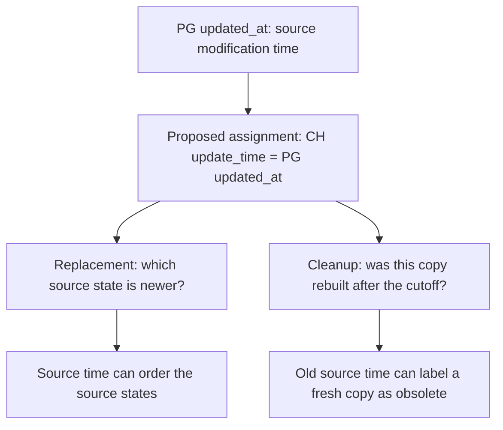
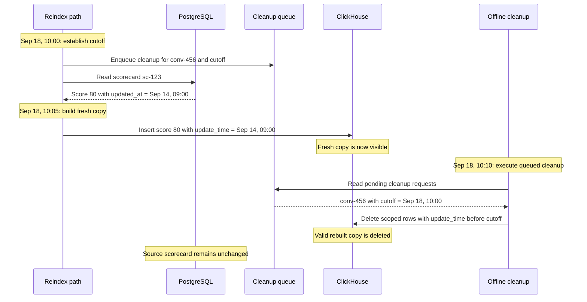
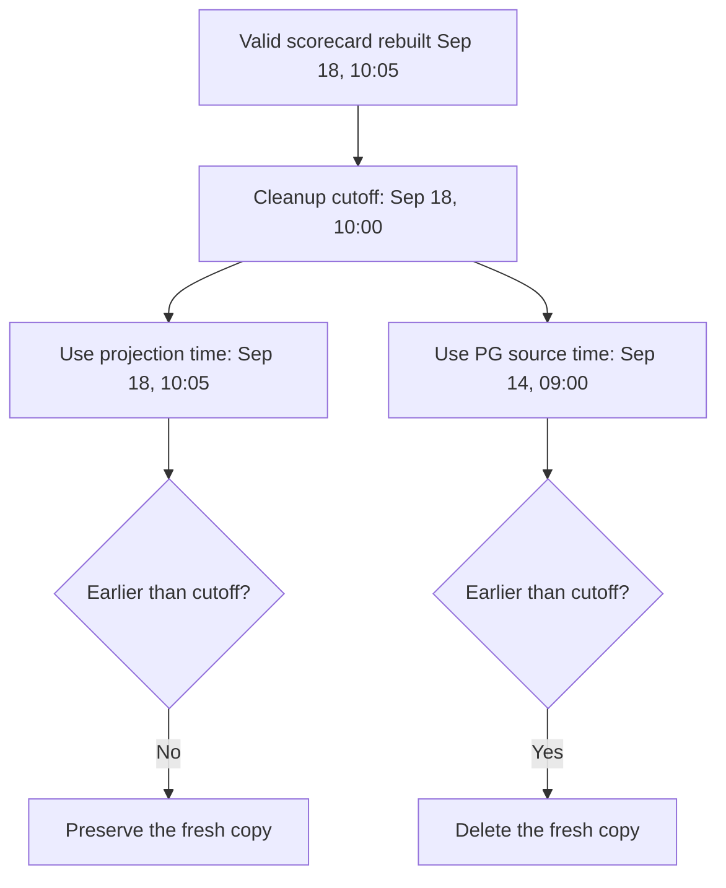

# Why assigning PostgreSQL `updated_at` to ClickHouse `update_time` breaks reindex cleanup

Written: 2026-09-21. Based on the source and local reproduction recorded in the September 19 investigation. Examples use synthetic data and UTC timestamps.

## 1. High-level understanding: one column, two conflicting assumptions

The proposed change was intended to make ClickHouse retain the newest PostgreSQL scorecard state even when asynchronous writes run out of order:

```text
PostgreSQL updated_at → ClickHouse update_time
```

The idea is reasonable for choosing between versions: a later source modification should win over an earlier source modification, regardless of which copy arrives first.

However, an existing reindex cleanup also uses ClickHouse `update_time`. It assumes that the field records when a projection was built for insertion into ClickHouse. It deletes rows whose timestamp is older than a cutoff established for the reindex job.



Read the two branches as two consumers of the same column. The assignment supplies source time to both, although cleanup expects projection time.

Those consumers ask different questions:

| Consumer | Question | Meaning it needs from its ordering/freshness field |
|---|---|---|
| Version replacement | Which source state is newer? | Source version or source modification order |
| Reindex cleanup | Was this copy rebuilt after the reindex cutoff? | Projection-building time or an explicit rebuild marker |

**A scorecard can be unchanged in PostgreSQL for months and still have a completely valid ClickHouse copy rebuilt just now.** Its source timestamp is old; its projection is fresh.

Assigning the source timestamp to `update_time` changes the field's meaning for replacement, but leaves cleanup interpreting it as projection time. Cleanup can consequently delete valid, freshly rebuilt rows.

The failure is a conflict between contracts. It does not establish that source-version ordering is inherently wrong, and it does not establish that indexing time is a reliable source version.

## 2. The timestamps, precisely

| Field or event | Meaning in the inspected source | Does reindexing an unchanged PG row advance it? |
|---|---|---|
| UI action time | When the person acts in the browser | No; this is not the authoritative database version |
| PG `updated_at` | Source scorecard modification timestamp | No |
| CH `scorecard_last_update_time` | PG `updated_at` copied into the analytical row | No |
| CH `update_time`, before the proposed substitution | Application `time.Now()` when the projection row is built | Yes, when a new row is built |
| Actual CH insertion/visibility time | When CH receives the write and when readers can see it | Happens later; not exactly what `time.Now()` records |

PG changes can originate from the UI, AutoQM, administrative operations or other backend paths. Calling `updated_at` the “last UI touch time” is therefore only an approximation. It is also not necessarily a database commit timestamp or a strictly monotonic revision.

Likewise, “CH insertion time” is convenient shorthand for the current `update_time`, but the code stamps the value before insertion. Network delay and Distributed-table delivery can separate building, insertion and visibility.

The inspected scorecard builder has two distinct assignments:

```go
ScorecardLastUpdateTime: scorecard.UpdatedAt,
UpdateTime:              time.Now(),
```

The reverted proposal changed the second one:

```go
ScorecardLastUpdateTime: scorecard.UpdatedAt,
UpdateTime:              scorecard.UpdatedAt,
```

It did not merely add source metadata; that metadata already existed. It changed the meaning of the column used by the replacement engine and cleanup. The proposal also changed the score-row builder, so criterion projections were affected as well as parent scorecards.

## 3. Why normal traffic can hide the difference

Consider one successful edit with fast propagation:

| Event | Time |
|---|---|
| Person edits a criterion | 09:00:00.000 |
| Backend records the modified scorecard | 09:00:00.100 |
| Projection row is built | 09:00:00.200 |
| CH receives the row | 09:00:00.250 |

Source modification time and projection time are only 100 ms apart. Both may give the same ordering relative to other rows and fall on the same side of a cleanup cutoff. Tests limited to fast, successful propagation can miss the distinction.

The contracts still differ. Even a small delay can matter if a cutoff falls between those times. Reindexing, backfills, retries and delayed processing make the separation easier to observe; reindexing often turns milliseconds into days or months.

## 4. Example: the ordering problem the proposal was trying to solve

Assume two source states of the same scorecard, with the same complete ClickHouse replacement key:

| State | Score | PG `updated_at` | Projection built and delivered |
|---|---:|---|---|
| A: earlier edit | 50 | 09:00 | 09:03, after delayed processing |
| B: later edit | 80 | 09:01 | 09:02 |

The worker for A has an older source snapshot but constructs its CH row after B's worker. For this example, building and delivery are close enough to treat them together.

The table's `ReplacingMergeTree(update_time)` uses the greatest `update_time` for equal sorting keys when resolving versions. Replacement happens through merges or query-time deduplication; insertion itself is not a transactional update of the old row.

With projection time as the version:

```text
A: score=50, update_time=09:03
B: score=80, update_time=09:02

Winner: A, because 09:03 > 09:02. The older source state wins.
```

With PG modification time as the version:

```text
A: score=50, update_time=09:00
B: score=80, update_time=09:01

Winner: B, because 09:01 > 09:00. The newer source state wins.
```

This is the benefit the proposal sought. It assumes the source timestamp correctly orders those states and each payload belongs to its timestamp. It does not address timestamp ties, incomplete snapshots or other writers, but it explains why the change looked attractive.

## 5. What the conversation reindex cleanup is trying to accomplish

Reindexing reconstructs the desired analytical rows from source data. Old projections can contain rows that should no longer exist—for example, a score row whose source record was removed. Inserting the current rows does not automatically remove an obsolete row with a different key.

The cleanup-enabled conversation reindex path uses a cutoff to distinguish old copies from rebuilt copies:

```text
old projection:      update_time < cutoff  → eligible for deletion
rebuilt projection:  update_time ≥ cutoff  → preserved by this predicate
```

The default cutoff is the job creation time. Configuration can select a valid earlier cutoff. The code does not simply use the clock at the moment cleanup executes.

The workflow and cleanup are separate pieces:

1. `ReindexConversations` passes scorecard/score cleanup options and the cutoff to `BatchIndexConversations`.
2. With the relevant paths enabled, the batch-index code enqueues cleanup for the selected conversations and tables. In the inspected code, this enqueue occurs before the batch's CH writes; it is not a synchronous deletion barrier.
3. The indexing path rebuilds and inserts rows. Scorecard/score existing-ID dedup is normally bypassed when their cleanup is requested so these rows can be refreshed.
4. The offline `delete-conversations-in-clickhouse` task later processes the queue and issues scoped deletions on the relevant shards.

The exact scheduling can vary. The failure example below uses a valid execution order in which newly inserted rows are visible before the offline deletion runs. Temporal does not itself issue a whole-database delete when the workflow finishes.

The following diagram shows that failure schedule under the proposed timestamp assignment. **Enqueuing cleanup and executing cleanup are separate events.** The reindex participant includes the workflow's batch-index call; the queue groups requests by conversation, table and cutoff.



## 6. Example: cleanup deletes a freshly rebuilt, valid scorecard

### Starting state in PostgreSQL

```text
scorecard_id:     sc-123
conversation_id:  conv-456
score:           80
updated_at:      2026-09-14 09:00:00
```

This scorecard is correct and still belongs in analytics. Nobody needs to edit it again merely because its modification timestamp is old.

### Reindex timeline

| Event | Timestamp |
|---|---|
| PG scorecard last modified | September 14, 09:00 |
| An old CH copy was built | September 15, 12:00 |
| Reindex job created; default cutoff fixed | September 18, 10:00 |
| Cleanup request enqueued for this batch | September 18, 10:01 |
| Correct PG row read, rebuilt and inserted into CH | September 18, 10:05 |
| Offline cleanup executes after the insert is visible | September 18, 10:10 |

The reindex operation only reads the source scorecard. PG `updated_at` remains September 14, 09:00.

### Cleanup predicate

The per-shard SQL is equivalent to this simplified example:

```sql
DELETE FROM scorecard
WHERE conversation_id IN ('conv-456')
  AND update_time < '2026-09-18 10:00:00';
```

The actual implementation can additionally restrict `scorecard_time` to a range. Customer/profile context selects the database and shard connections. A corresponding cleanup can target the `score` table.

The predicate does not query PostgreSQL, inspect the score's correctness, or compare source and destination payloads. It classifies the row by scope and timestamp.

### Same rebuilt row, two timestamp assignments

Both branches below start with the same valid scorecard and the same cleanup cutoff. Only the value assigned to `update_time` changes.



The existing assignment preserves the fresh copy in this schedule. The proposed source-time assignment deletes it even though its contents are correct.

### With the existing projection-time meaning

| Copy | Score | CH `update_time` | Matches deletion predicate? |
|---|---:|---|---|
| Old copy | 80 | September 15, 12:00 | Yes |
| Freshly rebuilt copy | 80 | September 18, 10:05 | No |

The old copy is eligible for deletion; the rebuilt copy survives. If replacement already discarded the old copy, the surviving rebuilt copy still does not match the predicate.

### After substituting PG `updated_at`

The newly built row instead contains:

```text
scorecard_id:                sc-123
score:                      80
scorecard_last_update_time:  2026-09-14 09:00:00
update_time:                2026-09-14 09:00:00
```

Cleanup evaluates:

```text
September 14, 09:00 < September 18, 10:00
                    true
```

**The valid row inserted five minutes ago qualifies for deletion.** Its old business modification time has been mistaken for evidence that this copy predates the rebuild.

If an old copy still carries September 15 indexing time, it also qualifies. If both old and new copies use the source timestamp, both qualify. Replacement/`FINAL` does not exempt a winning row from an explicit deletion predicate.

After cleanup, PostgreSQL still contains the correct scorecard, but ClickHouse can have no corresponding parent/criterion projection. If every selected row's source timestamp predates the cutoff, all those selected rows can qualify—not just malformed rows.

The scope is the queued conversations, tables and applicable time restrictions. This is not an unconditional deletion of all ClickHouse data. If the insert arrives after deletion instead, it can survive; that timing dependence does not make the substitution safe.

## 7. The conflict expressed as one condition

Let:

- `S` = source modification time;
- `C` = cleanup cutoff;
- `I` = time the row was built during this reindex.

An unchanged historical row rebuilt after the cutoff has:

```text
S < C ≤ I
```

With `update_time = I`, cleanup evaluates `I < C`, which is false.

With `update_time = S`, the same cleanup evaluates `S < C`, which is true.

The source state, projected values and cleanup code can all be unchanged. Changing the timestamp assignment alone changes a valid row from “preserve” to “delete.”

## 8. A separate migration problem: old and new version meanings can coexist

Even disabling cutoff cleanup would not make a writer-only switch sufficient.

Suppose an existing stale CH projection carries an indexing-time version of September 17. A correct reindex on September 18 uses PG's last modification time, September 14:

| Copy | Version value in `update_time` |
|---|---|
| Existing stale projection, built under the old convention | September 17 |
| Correct rebuilt projection, built under the new convention | September 14 |

For the same replacement key, the old projection outranks the corrected projection. The comparison mixes two different meanings of time. This is another reason a safe migration needs more than changing the row builder.

## 9. What follows for the design

The two questions need independent contracts:

- **Ordering:** a source version identifies which logical state wins. It must travel with the payload it actually describes.
- **Rebuild/deletion:** an explicit rule identifies copies or keys that are obsolete, accounting for rebuild completion, retries and concurrent writes.

Separate version and indexing fields can help express those contracts, but adding a second column alone is not a complete solution. For example, a same-source-version rewrite may be merged away together with its fresh indexing marker. Cleanup must remain correct after merges and partial rebuilds as well as before them.

Likewise, choosing a source timestamp does not automatically establish a robust source revision: timestamp precision, all relevant writers, parent/child consistency and changed projection inputs still matter. Delivery guarantees and safe delete/tombstone handling remain separate requirements.

This document explains the failure mechanism. The [broader option comparison](ui-pg-ch-ordering-options.md) covers staged mitigations, explicit revisions, outbox delivery, Temporal and CDC alternatives.

## 10. Evidence and limits

### Reading and portability

This document remains a single Markdown file. The three diagrams use standard Mermaid flowchart and sequence syntax without external images, custom JavaScript or theme configuration. GitHub and Mermaid-enabled Markdown previews can render them inline. A basic Markdown viewer may display the diagram code instead; the adjacent prose, tables and SQL explain the same argument independently. No separate HTML viewer or generated artifact is required to read the explanation.

### Investigation evidence

[PR #23999](https://github.com/cresta/go-servers/pull/23999) introduced the source-timestamp assignment and merged on November 5, 2025. [PR #24095](https://github.com/cresta/go-servers/pull/24095) reverted it on November 8, 2025. The cleanup contract is present in the exact original commit as well as the inspected September 19 backend snapshot.

The September 19 investigation executed synthetic cases with ClickHouse local 26.8.2.7. They confirmed source-version ordering, actual deletion of fresh rows carrying old source timestamps, and rejection of repairs when old/new version meanings are mixed. See the [SQL](../sessions/2026-09-19/ordering-counterexamples.sql) and [recorded results](../sessions/2026-09-19/ordering-check-results.txt). The reproduction used deterministic integer clock values with actual MergeTree engines; it did not reproduce production topology or query timing.

The original incident's exact workflow run, tenant, deployment flags and affected IDs have not been independently recovered. The examples establish a concrete code-supported failure mechanism; they are not proof that a particular historical production deletion took this exact schedule. This documentation follow-up did not rerun production operations or the earlier tests.

### Pinned source references

These links use the inspected backend commit `ab941601e66af653b19a7cf91777b793bdedb2c7`, except where explicitly marked historical. They describe source behavior, not current deployment state.

| Detail | Source |
|---|---|
| Source timestamp and projection timestamp assigned separately | [Scorecard builder](https://github.com/cresta/go-servers/blob/ab941601e66af653b19a7cf91777b793bdedb2c7/shared/clickhouse/conversations/conversation.go#L3065) |
| Default cutoff is job creation time | [getCleanUpClickhouseCutOffTime](https://github.com/cresta/go-servers/blob/ab941601e66af653b19a7cf91777b793bdedb2c7/temporal/ingestion/reindexconversations/activity.go#L183) |
| Cleanup tables, dedup bypass and indexing-time assumption | [Conversation reindexer](https://github.com/cresta/go-servers/blob/ab941601e66af653b19a7cf91777b793bdedb2c7/temporal/ingestion/reindexconversations/conversation_reindexer.go#L300) |
| Cleanup enqueue is initiated before the batch's writes | [Batch-index entry](https://github.com/cresta/go-servers/blob/ab941601e66af653b19a7cf91777b793bdedb2c7/apiserver/internal/internalconversation/action_batch_index_conversations.go#L394), [enqueue implementation](https://github.com/cresta/go-servers/blob/ab941601e66af653b19a7cf91777b793bdedb2c7/apiserver/internal/internalconversation/action_batch_index_conversations.go#L813) |
| Offline task consumes table/cutoff/conversation groups | [Cleanup task](https://github.com/cresta/go-servers/blob/ab941601e66af653b19a7cf91777b793bdedb2c7/cron/sync-users/internal/delete-conversations-in-clickhouse/delete_latest_conversations_in_queue.go#L130) |
| Scorecard and score cutoff predicates | [DeleteConversationsFromClickhouseWithCutOffTime](https://github.com/cresta/go-servers/blob/ab941601e66af653b19a7cf91777b793bdedb2c7/shared/clickhouse/conversations/conversation.go#L1642) |
| Actual DELETE construction and per-shard execution | [DeleteOnShardFromClickhouseWhere](https://github.com/cresta/go-servers/blob/ab941601e66af653b19a7cf91777b793bdedb2c7/shared/clickhouse/conversations/conversation.go#L1417) |
| Same indexing-time cleanup contract in original proposal's commit | [Historical reindexer](https://github.com/cresta/go-servers/blob/d04ef2d3faeaadc0bb36760c1a75017675169b37/temporal/ingestion/reindexconversations/conversation_reindexer.go#L323) |
