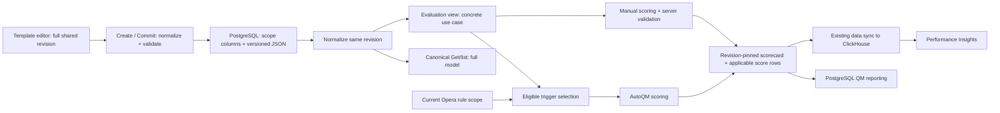
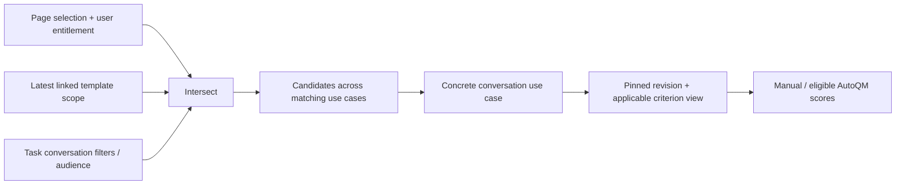

# Omni-use-case scorecard workflows: engineering plan

**Author / design owner:** Xuanyu Wang; draft prepared with Codex\
**Status:** Draft for engineering review; no implementation or rollout approval implied\
**Last updated:** November 4, 2026\
**Primary domain:** Scorecard Workflows / Template Authoring and Versioning\
**Product input:** [Omni Use Case QM / Coaching PRD](https://docs.google.com/document/d/1iEYDUg7NrYo5NjeTcr9nHyNqEbv_sWHrDHJeAkFJS9c)\
**Company format:** supplied engineering-plan template, originally dated October 17, 2023\
**Continuing work:** [canonical work item](../work-items/omni-usecase-scorecard-plan.md)

This design keeps one template identity and one revision history across use cases. Template applicability remains in PostgreSQL `usecase_ids`. Each criterion gets explicit applicability inside the versioned template JSON and typed Go model. Evaluations use their concrete use case and pinned template revision; criteria outside that use case have no score row. Performance Insights and QM then read the same facts over a selected set of use cases, together and separately.

**Reading the status labels:** “Confirmed decision” means Xuanyu settled the behavior in the linked design discussions or this review. “Verified source” means code was checked at the immutable commits below; it does not establish deployment or measured performance. “Proposed” means an engineering recommendation for review. The November 4 decisions are captured [separately](../decisions/2026-11-04-omni-usecase-autoqm-and-reporting.md).

## Goal

- Author one conversation performance template for A+B, retaining shared criterion identity, scoring options, weights, and revision history while allowing a criterion to apply only to B.
- Make manual and AutoQM scoring enforce that applicability on the server. A missing automatic rule must not manufacture an N/A score in an uncovered use case.
- Deliver the P0 journey in this order: template configuration, Performance Insights, QM task, QM Task Home, and QM Report. Show combined selected-use-case results and per-use-case breakdowns with consistent filters and permissions.
- Preserve historical evaluations when template scope changes, and prevent older clients, jobs, or direct SQL readers from silently broadening scope or losing evaluations.
- Provide a reviewable implementation sequence, compatibility strategy, test plan, operational checks, and planning estimates.

Success requires a shared A+B template and task to work in both A-only and B-only views, combined metrics to reconcile with their breakdown at the correct grain, and old scorecards to remain available after B is removed from the current template. Single-use-case behavior must remain equivalent.

## Non-goals

- Independent criterion resources, cross-template criterion sharing, or independently versioned criteria.
- An authoritative criterion table or a global materialized-view refresh on each template edit. Direct criterion lookup remains a separate engineering requirement, deferred until a concrete query justifies a derived index.
- Per-use-case QM quotas, automatic historical rescoring, rewriting old template revisions, or automatically changing existing scorecard/task associations.
- Enabling `enableGlobalOperaRule` for customers. Separate per-use-case Opera rules attached to one criterion are the baseline; one shared rule is supported where that authoring flag is enabled.
- Broadening group-calibration tasks to multi-use-case tasks, changing scorecard permissions to use historical permissions, or redesigning scorecard mutation concurrency.
- Delivering the Coaching plan model in P0. Coaching and data-platform exports need compatibility work before general exposure; their broader product changes are described as follow-up dependencies below.

## Background

A **use case** partitions conversations and associated access/configuration. A **template** defines chapters and criteria and has its own audience, permissions, and revisions. A **criterion** is a template-owned item, possibly nested under a chapter or conditional branch. A **scorecard** evaluates a concrete conversation or process and records a template ID, revision, and concrete use case. A **score row** records an evaluated criterion; it is different from the criterion definition. A **QM task** attaches audience, quota, schedule, and conversation filters to a template. An **Opera rule** owns behaviors whose annotations can drive AutoQM through `auto_qa.triggers` on an ordinary criterion.

Today, scope exists at template level but not criterion level. A shared template therefore cannot express “quality applies to A+B, chat-specific applies only to B.” Several consumers further copy or assume a single use case. Merely adding a JSON field would leave scoring, task discovery, and reports inconsistent.

### Verified source baseline

Source was refreshed with `git fetch origin main` and read with `git show` / `git grep`, without switching branches or changing product code:

| Repository | Verified commit | Context |
| --- | --- | --- |
| go-servers | `01c0d818b7793656005500f84efb2d1b69aa54bd` | fetched `origin/main`, November 4; primary source |
| director | `a03e8e6597da5619fdbeb4e2b29120147ca1c2a1` | fetched `origin/main`, November 4 |
| cresta-proto | `1938bb241393f0f54e5dd8242f03ba1a6617728e` | fetched `origin/main`, November 4 |

| Fact checked at those commits | Design consequence | Evidence |
| --- | --- | --- |
| Both template tables store `usecase_ids` separately from `template JSONB`; scorecards store concrete `usecase_id` and `template_revision`. | Keep the storage split and revision pin. | [S1], [S2] |
| `ScorecardTemplate.template` uses protobuf Struct; Go has typed criterion/parser structures. Parser accepts V1/V2 only; AutoQM DAO paths explicitly skip versions other than 2. | Add schema support and remove hard-coded V2 assumptions before V3 writes. | [S3], [S4], [S5] |
| Create/Commit converter parses the structure but stores the original JSON; Commit writes both tables in one transaction and looks up the old row using incoming use cases. | Normalize before persistence; load old revision by identity before applying new scope. Strengthen concurrent Commit serialization. | [S6] |
| `ListCurrentScorecardTemplateIDs` filters scope before `DISTINCT ON (customer, profile, usecase_ids, resource_id)`. | Choose the current revision by identity first; otherwise old revisions with old scope can survive discovery. | [S7] |
| Builder reads `triggers[0]` and replaces the list with zero or one trigger; picker defaults to the page use case. | Extend authoring, validation, display, and saves together. | [S8] |
| Opera multi-use-case picker is gated by `enableGlobalOperaRule`; policy use cases propagate to behavior records. | Support several use-case-specific behavior references without requiring the flag. | [S9] |
| AutoQM processes all template AutoQA items, then each trigger, without criterion/rule use-case selection at those seams. Empty evidence can become NOT_APPLICABLE. | Select applicable criteria and eligible rules before evidence/outcome interpretation. | [S10] |
| QM backfill copies `UsecaseIds[0]` and skips all-use-case templates; task-ID backfill matches singular task scope. | Migrate job logic together with live task reads. | [S11] |
| QM task discovery filters singular `tasks.usecase_id`; the period and overall-chart scorecard queries omit the selected use-case predicate. Manual-QA frontend still overrides the list with one use case. Appeals stats require exactly one use case. | Shared templates require changes beyond template discovery. | [S12], [S13] |
| QA filters already accept multiple use cases and criteria, but QA grouping enum has no use-case dimension. The ClickHouse builder now has additional conversation-version logic. | Add grouping through the existing builder, retaining current population/version semantics. | [S14], [S15] |

The October investigations remain useful decision evidence, but their source snapshots are older. The staging ClickHouse `EXPLAIN ESTIMATE` compared one/two-use-case filters in a sample with no shared template; it was not a latency benchmark. The October `voice-sandbox-2` NULL/version census covered one database only. Neither is current deployment evidence. No database, deployment configuration, or flag rollout was queried for this plan.

## Overview

### Model first: one revision, several effective views

The following SQL is an excerpt of **existing** storage, not a migration. Actual tables have additional columns. `scorecard_templates` contains revision rows, not just a mutable singleton; do not assume one row per template ID.

```sql
CREATE TABLE director.scorecard_templates (
  customer VARCHAR NOT NULL,
  profile VARCHAR NOT NULL,
  resource_id VARCHAR NOT NULL,  -- template identity
  revision VARCHAR NOT NULL,
  usecase_ids VARCHAR[],         -- existing NULL / '{}' legacy ALL behavior
  template JSONB NOT NULL,
  PRIMARY KEY (customer, profile, resource_id, revision)
);

CREATE TABLE director.scorecard_template_revisions (
  customer VARCHAR NOT NULL,
  profile VARCHAR NOT NULL,
  resource_id VARCHAR NOT NULL,  -- revision ID in this table
  template_id VARCHAR NOT NULL,
  usecase_ids VARCHAR[],
  template JSONB NOT NULL,
  PRIMARY KEY (customer, profile, resource_id, template_id)
);
```

For a revision whose SQL scope is `ARRAY['A','B']`, the **proposed V3 JSON** is:

```json
{
  "version": 3,
  "items": [
    {
      "identifier": "quality",
      "displayName": "Quality",
      "type": "numeric-radios",
      "weight": 1,
      "settings": {"range": {"min": 0, "max": 5}},
      "usecase_ids": ["A", "B"],
      "auto_qa": {
        "triggers": [
          {"type": "behavior", "resource_name": "customers/example/profiles/main/behaviors/quality-a"},
          {"type": "behavior", "resource_name": "customers/example/profiles/main/behaviors/quality-b"}
        ],
        "detected": 5,
        "not_detected": 0
      }
    },
    {
      "identifier": "chat-specific",
      "displayName": "Chat-specific",
      "type": "numeric-radios",
      "weight": 1,
      "settings": {"range": {"min": 0, "max": 5}},
      "usecase_ids": ["B"]
    },
    {
      "identifier": "retained-for-later",
      "displayName": "Retained for later",
      "type": "sentence",
      "weight": 0,
      "usecase_ids": null
    }
  ]
}
```

A/B and resource names are illustrative. The first criterion refers to an A-only and a B-only behavior; those rule scopes live in Opera, not in the trigger JSON. A scorecard in A can write `quality` only. A scorecard in B can write `quality` and `chat-specific`. Neither writes `retained-for-later`. The NONE criterion remains part of the revision and can be reactivated by a later template use-case addition.

The following Go is an **illustrative addition**, not current or copy-ready implementation. Keep raw field presence until normalization; only then use the compact typed representation:

```go
// Parser input, before legacy defaults or new-write validation.
type criterionInput struct {
    UsecaseIDs json.RawMessage `json:"usecase_ids"`
    // Existing criterion fields omitted.
}

// Addition to the existing BaseCriterion after normalization.
// nil => NONE; pointer to empty slice => ALL profile use cases;
// pointer to nonempty slice => explicit included IDs. No omitempty.
type BaseCriterion struct {
    UsecaseIDs *[]string `json:"usecase_ids"`
    // Existing criterion fields omitted.
}

// Proposed shared boundary. TemplateScope comes from this revision's SQL row.
type TemplateScope struct {
    All bool
    IDs []string
}
type ParseMode int
const (
    HistoricalRead ParseMode = iota
    NewDefinition
)
// NormalizeRevision(rawJSON, templateScope, mode) -> full normalized tree
// ApplicableCriteria(normalizedTree, concreteUsecaseID) -> evaluation view
```

`json.RawMessage` is absent/nil for omission, bytes `null` for explicit NONE, and bytes `[]` for ALL. A plain `*[]string` at the parser boundary collapses omission and null and is insufficient. The implementation must validate JSON types, IDs, duplicates, ownership, and containment; this excerpt only shows representation.



The normalizer owns representation; evaluation owns applicability; report queries own population and metric grain. A filtered evaluation view must never be saved back as the canonical template.

## User Experience

### 1. Template configuration

The editor selects A+B once and displays scope on every criterion, including branch children. A newly created criterion defaults to the template's scope. A retained NONE criterion displays “No use cases.” Chapters have no separate scope; hide an empty chapter in evaluation while keeping its structure in authoring.

Adding C to the template adds C to all criteria as an editing default, including NONE criteria. Removing A removes A from every criterion. The editor then allows explicit criterion changes before saving the complete final definition. If removing A would leave B with no applicable criterion, show the exact coverage error and block save until corrected. Any reachable criterion counts toward coverage, including sentence/date/user criteria; coverage does not guarantee a numeric QA score.

“ALL” means all profile use cases, including future ones. Narrowing criteria first requires a finite template selection. Changing a finite template back to ALL displays the consequence and requires explicit confirmation: **all criteria, including NONE, reset to ALL**. A cancelled confirmation leaves the edit unchanged. This behavior was confirmed November 4; it does not introduce a template NONE state.

The AutoQM picker loads the union of rules for the template's authorized use cases, displays each rule's coverage and status, and can attach A-only and B-only rules to one criterion. Multi-use-case rules appear where available; the editor does not enable the Opera authoring flag. Show uncovered use cases as “Manual scoring only.” Reject overlapping linked-rule coverage on a criterion, including global-plus-specific coverage. Do not try to infer whether different rule names mean the same business behavior.

### 2. Performance Insights

A local multi-select initializes from the page's top-level selection, then controls template discovery, score/conversation queries, examples, drilldowns, and export. The picker shows a shared template once. Use entitled use cases only; changing the set invalidates relevant cached data.

Show current template/criterion applicability separately from historical results. Results include the combined selected set and a per-use-case breakdown. For a criterion that does not apply, display “Not applicable” (or the established N/A presentation) without synthesizing a score row. An applicable but unscored/manual-only criterion displays “No score,” distinct from explicit scored N/A. Historical results can remain present when current applicability has changed.

### 3. QM task

Select one template, then edit audience, quota, schedule, and conversation filters. The task displays the template's full current scope; there is no independent task scope selector. Conversation filters may narrow candidate selection without redefining the task's scope. Multiple tasks may share the same template. Quotas remain task-wide.

### 4. QM Task Home

List assigned tasks across entitled use cases and allow local narrowing. Suggest conversations from the intersection of the selected use cases, entitlement, current template scope, audience, and task conversation filters. Evaluate each conversation in its concrete use case. No eligible conversations produces an empty result with an explanation, never a fallback to a broader set.

### 5. QM Report

Use the same local selected set across Evaluations, Appeals, Group Calibrations, drilldowns, and CSV. Keep Evaluations' combined row at **template × task × cycle** and add per-use-case counts in detail. A shared A+B task appears once, not as cloned tasks.

For a B-only view, show B's evaluated count and mark task completion rate **N/A**. Label the quota as whole-task; do not divide B's count by A+B's quota. The same rule applies when permissions expose only a subset of task scope. Display a completion rate only when the requested, authorized view covers the whole task scope and the existing time-period/quota rules permit it. Never fetch unauthorized A counts just to compute a percentage.

Group calibrations can be listed across selected use cases while each calibration task retains its existing concrete use case. Coaching UI changes follow separately.

## Detailed Design

### Scope semantics and validation

| Layer / encoded value | Meaning | Read/write contract |
| --- | --- | --- |
| Template SQL NULL or empty array | ALL under existing legacy semantics | Preserve reads; new writes canonicalize ALL to a non-null empty array. No template NONE. |
| Template nonempty array | Finite included scope | Validate same-profile use cases; remove duplicates / use deterministic ordering. |
| Historical V1/V2 criterion field omitted | Inherit that revision's template scope | Normalize in memory; never consult the latest revision for this default. |
| Criterion JSON `null` | NONE | Keep criterion identity and definition; no applicable score row. Finite template required under the authoring rule. |
| Criterion JSON `[]` | ALL profile use cases | Valid only under an ALL template under the agreed authoring rule. It does **not** mean “inherit finite template scope.” |
| Criterion nonempty array | Finite included scope | Subset of the revision's template scope; finite template required before narrowing. |
| New V3 criterion field omitted | Invalid definition | Reject; never silently inherit or recover by matching IDs. |

Confirmed invariants:

1. Criterion scope is contained by **its own template revision**, and branch-child scope is contained by the parent criterion's scope. Traverse all nested items and branch children.
2. A conversation template has at least one reachable applicable criterion for every included use case. A branch child outside an absent parent cannot satisfy coverage.
3. Canonical Get/list returns the full shared definition, normalized from the requested revision. Evaluation views are derived separately.
4. Historical scorecards retain concrete use case, pinned revision, scores, and task associations after future edits. Current template permissions remain the permission policy; historical structure does not confer historical access.
5. An inapplicable criterion has no score row, no aggregate weight, and cannot be supplied in an accepted score mutation. Explicit N/A on an applicable criterion remains the existing score concept.
6. A template-based QM task follows current template scope for future evaluations; audience, schedule, quota, and conversation filters stay task-owned.

For finite template scope T, new scope T′, and criterion C, the editing default is:

`C′ = (C ∩ T′) ∪ (T′ − T)`

Treat NONE as the empty mathematical set, then serialize a resulting empty set as JSON `null`, **never `[]`**. ALL is symbolic rather than a list of currently known IDs.

| Edit | Before | Default after |
| --- | --- | --- |
| Add C | template A+B, criterion A | template A+B+C, criterion A+C |
| Remove A | template A+B, criterion A | template B, criterion NONE |
| Add C to retained NONE | template B, criterion NONE | template B+C, criterion C |
| ALL → finite A+B | template ALL, criteria ALL | template A+B, all criteria explicitly A+B |
| Finite → ALL | template A+B, mixed scopes | explicit reset confirmation; all criteria ALL |
| Final explicit editor change | automatic addition gave A+C | author may submit A, subject to final coverage and containment |

The ALL authoring rule avoids a separate event that must add each newly created profile use case to finite criterion lists under an ALL template. It limits flexibility intentionally; changing that rule requires a new design decision.

### Schema version and normalization

**Proposed:** introduce V3 using the current V2 `items` tree plus required criterion `usecase_ids`. A version discriminator makes new-write omission errors explicit and prevents treating dropped scope as legacy inheritance. Alternatives are adding an optional V2 field (weaker write discrimination) or a tagged object `{mode, ids}` (clearer but larger representation, inconsistent with the agreed compact encoding). Recommend V3; this is an engineering proposal rather than a previously settled version number.

Implement a normalization boundary that receives the whole revision context: original JSON version, JSON structure, and same-row SQL template scope. Parse V1/V2 using their existing shapes and materialize missing scope from that row. Parse V3 with required scope presence. Explicit null/empty/IDs must survive serialization. Reject unsupported versions and malformed fields instead of normalizing them to ALL.

New saves serialize the normalized final typed tree, not the original input bytes. Both template tables must receive identical scope and structure for the new revision. Preserve current scoring settings, comments, branching, per-message configuration, unknown-field handling policy, and identifier behavior through round-trip fixtures. Do not assume normalization is just changing `version` to 3; V1 shape conversion and nested branches need explicit handling.

Audit every `ParseScorecardTemplateStructure` caller and every strict `version == 2` check. Replace version gates with explicit supported capabilities. API converters, score calculation, AutoQM/backfill, exports, group-calibration SQL, and direct template readers must consume compatible representations. SQL needing criterion definitions cannot call a Go normalizer; use version-aware extraction or read the corresponding normalized revision in application code. Defer a global criterion projection until those queries require it.

### Create / Commit and concurrent edits

Keep full-template Commit as the P0 API. Load current revision by customer/profile/template identity, without filtering it by incoming scope. Validate authorization against the relevant old and final scopes, then compare the caller's expected revision to the current revision. Scope replacement A→B must be possible for an authorized author even though the sets are disjoint.

The existing revision comparison occurs before the insert transaction [S6]. A transaction around two inserts alone does not serialize two writers that read the same old revision. **Proposed:** serialize Commit for each template using a transaction-scoped lock keyed by customer/profile/template ID, reload the latest row after obtaining it, and check expected revision inside the transaction. Choose the repository's established lock facility during implementation; if using a PostgreSQL advisory lock, use stable namespaced keys and require every template mutation writer to participate. Locking only an old revision row and failing to re-read latest is insufficient. Return a caller-visible revision conflict; the editor reloads and requires reconciliation rather than silently replaying the whole stale definition.

For a full definition, the backend validates the final explicit scopes and does not reapply template additions over the author's choices. Validate nested coverage, reference ownership, AutoQM rule eligibility, and format before writing. Atomically insert the new rows in both tables and update any existing derived trigger index from the normalized model. No successful response can expose a revision whose corresponding companion row was not committed.

A `FieldMask` for use-case-only updates is **deferred**. If added later, it must load the prior complete definition, apply the confirmed transition on the server, validate, and create a revision through the same concurrency protocol. It cannot be implemented as a column-only update. Full Commit remains the editor contract and expected-revision check remains mandatory.

### Manual evaluation and score mutations

Resolve the scorecard's concrete use case and pinned template revision before deriving applicable criteria. For creation, validate the selected current template is applicable to the concrete use case; for existing scorecards, use their stored revision rather than today's scope. Missing/invalid concrete use case on legacy rows requires audit and an explicit migration decision; never default it to ALL.

Use the applicable criterion view in create, update/autosave, submit, validation, scoring, appeals edits, calibration evaluation, exports, and any regeneration path. Validate required criteria and branch reachability within that view. Reject an otherwise known criterion ID that is outside scope with a field-specific InvalidArgument; do not silently accept it or turn it into N/A. Current mapping only checks membership in the full tree and can skip unknown IDs [S2].

`ComputeScores` already skips criteria with no score rows [S2]. Reuse its established option/weight/N/A behavior after applicability selection. A template with only applicable sentence/date/user items can yield no numeric aggregate; preserve that distinction from an invalid zero-criterion configuration. Do not delete existing historical rows because the latest revision changes applicability. Use existing protected scorecard mutation/recomputation paths; the [reviewed race recommendations](../../scorecard-data-sync/deliverables/scorecard-races-corrected-recommendations.md) are a separate concurrency dependency, not a claim that this design implements them.

### AutoQM rule selection

**Confirmed November 4:** uncovered criterion use cases remain manually scorable; reject overlapping rule coverage in new mappings; check the rule's current scope for every new AutoQM run. Stored historical scores stay unchanged. A template revision pins criterion/configuration, but does not snapshot the entire Opera policy or promise reproduction of historical annotations.

For concrete use case U:

1. Select criteria applicable to U from the scorecard's chosen revision.
2. Batch-resolve linked behavior/policy references within customer/profile and load current rule scope and supported status. Translate Opera's `all-usecases` sentinel explicitly; it is different from scorecard JSON empty-list encoding.
3. For each criterion, intersect linked rule scopes with criterion scope; select only eligible rules for U. Drop ineligible rules **before** looking for evidence or applying `showNA`.
4. With zero eligible rules, leave the criterion available for manual scoring and generate no automatic score for it. With one eligible rule, use the existing scoring mapping. Missing evidence for an **eligible** rule retains established N/A/outcome behavior.
5. With conflicting eligible rules caused by a later Opera scope change, do not combine evidence or choose implicit precedence. Skip automatic scoring for that criterion, record a diagnostic, and surface configuration repair; manual scoring remains available. Preserve existing stored scores. Do not overwrite them with synthetic N/A.

New definition validation rejects duplicate references and overlapping effective coverage **within the criterion's scope**. Distinct A-only and B-only behaviors are valid. A global behavior plus an A-only behavior is invalid on a criterion applicable to A. Coverage outside criterion scope does not alone create a collision. Recheck at runtime because Opera can change independently. Policy edit-time cross-template validation is a possible later enhancement; runtime correctness cannot rely on it.

The single-rule-per-use-case mapping applies to new scope-aware configurations. Audit legacy multi-trigger configurations before upgrading them: some may intentionally combine evidence today. Do not reinterpret them silently. Keep legacy behavior while the feature is disabled; require explicit mapping repair or a separate supported combination contract before enabling affected templates. Also inventory legacy policy, metadata, SDX/moment, and behavior trigger types; scoped V3 AutoQM authoring must reject trigger types whose eligibility cannot be resolved safely rather than pretend they are global. Preserving existing legacy clients/configurations and supporting every trigger type in V3 are different requirements.

Use a request/job-batch lookup cache to avoid a rule query per criterion or conversation, with invalidation or a freshness bound appropriate to the run. Do not serve a stale positive eligibility decision after a scope restriction. Exact cache mechanism and maximum acceptable age require evaluation with the Opera owner; a run must record which policy state it used for diagnosis. If rule metadata is unavailable, treat that as an error/retry or an explicit skipped automatic item, never as “no matching evidence.” Existing behavior when all AutoQM items are empty should be retained unless separately changed; do not create an empty automatic scorecard solely to represent an uncovered criterion.

### Revision-safe discovery and historical reads

Separate two questions:

- **Current authoring/evaluation discovery:** first choose one latest revision by `(customer, profile, resource_id)`, then apply its activation/deletion/scope/audience filters. Do not group by scope and do not prefilter to an old matching revision.
- **Historical reporting discovery:** identify eligible template/task identities from authorized historical scorecards and stored task links for the requested range, then load metadata and pinned definitions. Latest scope cannot remove an old B scorecard from a B report. Label archived/currently-inapplicable templates as appropriate.

The proposed query shape below illustrates ordering only; production SQL must retain the endpoint's status, permission, and pagination rules and its canonical latest ordering:

```sql
WITH latest AS (
  SELECT DISTINCT ON (customer, profile, resource_id) *
  FROM director.scorecard_templates
  WHERE customer = :customer AND profile = :profile
  ORDER BY customer, profile, resource_id, created_at DESC
)
SELECT * FROM latest
WHERE status = :active_status AND deleted_at IS NULL
  AND deactivated_at IS NULL
  AND (usecase_ids IS NULL OR usecase_ids = '{}'
       OR usecase_ids && :authorized_selected_ids::varchar[]);
```

Define/test deterministic handling of equal `created_at` values using the actual revision-order contract; a random revision ID is not chronological. The per-template write serialization must prevent ambiguous new concurrent current revisions. Historical SQL must retain both `template_id` and `template_revision` when resolving definitions. Template identity alone cannot interpret a historical criterion scope.

### 1. Template configuration implementation

Extend the Director criterion union types, editor defaults, nested traversal, validation, serialization, display-name resolution, and multiple-trigger picker. Fetch rule coverage for the union of selected template use cases; preserve archived references for display without treating archived rules as newly eligible. Update validators and renderers that inspect only `triggers[0]`, including legacy save wrappers. A newer multi-trigger definition must not be truncated when opened and saved.

Create/Commit server validation is authoritative. Frontend validation provides immediate feedback but does not protect non-UI writers. Include duplication/import/activation and administrative backfill paths in the writer inventory. Keep canonical full-template caches keyed by identity/revision; keep derived evaluation caches keyed additionally by concrete use case.

### 2. Performance Insights implementation

Use repeated selected use cases for QA score stats, conversation stats, and examples. Add use case as an explicit grouping dimension and response attribute to the existing QA stats API. Prefer one grouped request over one request per selected use case; per-use-case fan-out multiplies population queries and makes consistent filtering harder. This recommendation still requires query/load evidence.

Carry the scorecard's own `usecase_id` through latest-scorecard and `filtered_scorecard` CTEs, ordinary and metadata-filter query paths, grouping, row scanning, response encoding, and rendering. Preserve current conversation-version selection, ACL/population filters, time basis, deduplication, and scorecard source-version join. The newer builder has logic absent from the October sketch; do not replace it with that old query wholesale [S15].

```sql
-- Conceptual final aggregation after existing population/version/dedup CTEs.
SELECT filtered_scorecard.usecase_id, scorecard_score.criterion_id,
       sumIf(percentage_value * float_weight, percentage_value >= 0) AS numerator,
       sumIf(float_weight, percentage_value >= 0) AS denominator
FROM scorecard_score
JOIN filtered_scorecard
  ON scorecard_score.scorecard_id = filtered_scorecard.scorecard_id
 AND scorecard_score.scorecard_last_update_time =
     filtered_scorecard.scorecard_last_update_time
GROUP BY filtered_scorecard.usecase_id, scorecard_score.criterion_id;
```

This SQL illustrates grouping and the retained join; it is not the complete production query. `scorecard_last_update_time` is the parent source version, not ClickHouse arrival time. Keep it with scorecard ID to avoid mixing a newer parent with older criterion scores. Projection completeness/repair belongs to Scorecard Data Sync.

For additive weighted facts, combined ratio is `sum(numerator) / sum(denominator)`, not the mean of use-case percentages. For example, A=80/100 and B=1/10 combine to 81/110, not 45%. Preserve existing metric definitions where the API averages at a different grain; prove reconciliation at each endpoint's actual grain. Distinct conversation counts across criterion or task groups are not generally additive. Zero denominator returns the established missing/N/A presentation, never numeric zero.

Use current definitions for the applicability/configuration table and pinned historical facts for result tables. Do not discard old scores by checking today's criterion scope. If the report range spans scope changes, expose the current-scope label separately from historical results; provide pinned revision context in drilldown.

### 3. QM task implementation

**Proposed representation:** derive effective future task scope from the linked template's current revision rather than storing another plural authoritative scope. Retain the existing singular task field for other task types and legacy compatibility; it must no longer be the QM applicability predicate. Add an output-only resolved scope to the task API so the frontend does not infer it from the copied singleton.

Validate new QM tasks have one existing same-profile template link in `qmTaskContentConfig`; reject missing/stale/cross-profile links on writes. Scope follows template changes without updating every task. Resolve latest template before applying overlap in task lists, GetTask authorization/discovery, evaluation-period queries, progress, reports, and suggestions. Batch joins/lookups and benchmark realistic task/template cardinalities. If derived reads are too expensive, an indexed projection can be proposed later with transactional synchronization and repair ownership; a task-owned user-editable list would violate the confirmed product invariant.

Audit legacy tasks with missing/deleted/stale links. Quarantine invalid future assignment with actionable diagnostics and repair mapping from verified configuration; do not guess a template from a copied use case. Historical scorecards can still be read through existing task IDs under authorization. Template inactive/archive/deletion semantics need the lifecycle owner to confirm: proposed future-evaluation behavior is to stop new suggestions/automatic assignment and retain existing historical task references. Do not cascade-delete history as part of scope migration.

Task conversation filters remain independent. Their use-case predicate intersects template scope; it cannot broaden it. Removing B from a template affects future B suggestions and associations, not completed B evaluations. Mid-cycle scope changes leave the quota task-wide; no retrospective per-use-case allocation is inferred.

### 4. QM Task Home implementation

Extend `SuggestManualQAConversations` with an additive repeated field while preserving the legacy singleton fallback. Resolve one normalized effective set and pass it consistently to template applicability, task/period lookup, progress, and conversation retrieval. The current fallback only fills from the template if the task filter is empty; that is insufficient when a populated filter contains incompatible IDs [S12].



An empty intersection must short-circuit before calling a list API where empty means unrestricted. Deduplicate candidates at the existing conversation/evaluator grain. Assignment/remaining quota is one task-wide value, not the sum of independently computed A and B quotas. Avoid count-only calls per use case when a grouped or combined query can serve the same result; measure calls and rows, not just page counts.

### 5. QM Report implementation

| Surface | Required change | Historical / counting rule |
| --- | --- | --- |
| Evaluations discovery | Resolve current tasks through template scope for future work; union authorized historical task/template identities for report history. | Current scope removal cannot hide linked old scorecards. |
| Overall chart and task-cycle table | Pass selected use-case IDs into both scorecard queries and filter **before** aggregation. | Keep template × task × cycle combined grain and current submit-time/period rules. |
| Detail / export | Add explicit per-use-case breakdown, selected filters, and scope context; remove frontend singleton override. | Preserve actual score rows for overwritten-criterion counts; no fake inapplicable rows. |
| Completion rate | When selection/permission covers only part of task scope, return explicit unavailable completion status. | Keep task-wide quota labeled separately; preserve existing partial-period N/A. |
| Appeals | Replace exactly-one validation with validated authorized set; propagate to every query and picker. | Keep appeal permission and state logic unchanged. |
| Group Calibrations | Apply selected set across list/stats/session/scorecard retrieval. | Each calibration task remains singular-scope; use its linked/pinned definition appropriately. |

Filter scorecards by their stored `usecase_id`, template ID, task link, existing type/submission/time predicates, and access rules. A scorecard may have several task IDs; prevent duplication inside each intended task grain and do not claim that summing task totals equals distinct conversations. Keep existing no-task and calibrated/reference-scorecard semantics.

### Consumers outside the P0 product journey

| Consumer | Required compatibility before broad exposure | Separate follow-up |
| --- | --- | --- |
| Coaching overviews, progress, plans | Read V3 safely, use correct latest-template discovery, and never present out-of-scope criterion targets as applicable. | Plural coaching-plan scope, overlapping active-plan policy, multiple plans per agent, combined/breakdown UI and queries. |
| Group-calibration direct SQL | Understand legacy/V3 criterion scope where reading definitions; preserve task's own scope and revision. | No plural calibration-task redesign in this plan. |
| Data-platform template/criterion export | Replace “populate singleton only when len==1” ambiguity with an explicit reviewed multi-scope contract. | Proposed additive plural scope representation plus explicit ALL/NONE interpretation; agree with downstream consumers before release. |
| Backfill / administrative tools | Parse V3, use same applicability helper, and stop first-use-case assumptions. | Broad repair/reindex execution remains separately reviewed. |

These compatibility tasks are part of the V3 reader inventory even if their new UI is deferred. A feature flag hiding a page does not prevent a background job from reading V3 data.

## API

Keep `ScorecardTemplate.usecase_names` and `google.protobuf.Struct template`; criterion scope stays inside the versioned JSON and typed implementation. Canonical Get/list returns the full requested revision. Do not replace a shared template response with a use-case-filtered tree. Do not expose separate criterion write resources.

The following protobuf illustrates **proposed additive contracts**, not allocated production fields. Numbers for additions must be checked/reserved in cresta-proto during implementation; service messages must follow the company's 11X API conventions and generated-client workflow. The supplied template names 11X guidance but does not include it; a conformance review remains required.

```protobuf
// Existing request: retain usecase_name = 8 for old clients.
// Proposed addition to SuggestManualQAConversationsRequest:
repeated string usecase_names = 11;

// Proposed addition to QAAttributeType (current enum ends at 10):
// QA_ATTRIBUTE_TYPE_USECASE = 11;

// Proposed response dimension; attach to the existing QA grouping envelope.
message QAUsecaseDimension {
  string usecase_name = 1;
}

// Proposed output-only resolved task scope, populated for template-based QM tasks.
// Empty repeated names alone must not conflate ALL and unresolved legacy data.
message ResolvedQMTaskScope {
  enum Mode {
    MODE_UNSPECIFIED = 0;  // unresolved/invalid, never interpreted as ALL
    ALL = 1;
    INCLUDED = 2;
  }
  Mode mode = 1;
  repeated string usecase_names = 2;
  string scorecard_template_name = 3; // resolved revision used for this read
}
```

For suggestion input: repeated names take effect when populated; singleton remains the legacy fallback. If both are populated, require a consistent singleton set or reject conflicting input instead of silently choosing one. An absent set uses the authorized task/template intersection; a user selection resolving to zero members is a real empty result, not absent input. Response grouping includes explicit use-case resource names without changing existing ungrouped responses.

QM report responses need per-use-case detail plus explicit completion availability/reason, such as partial use-case scope versus partial period. Do not encode a new status as zero percent or rely on a previously numeric-only field to carry null. Final attachment points and field allocation require API owner review; old-client handling must be tested with generated clients.

Use valid same-profile resource names at API boundaries and raw use-case IDs only inside revision JSON/DB as established. Reject cross-profile references, unsupported groupings, and malformed/new omitted scopes. Preserve standard permission-denied and not-found behavior to avoid revealing unavailable resource existence. Do not change existing Commit error codes speculatively; align caller-visible revision conflict handling with the shared API convention during implementation.

## Storage

### PostgreSQL

No new authoritative criterion table and no new blob/object storage. Preserve both existing template tables, their scope columns, historical rows, scorecard revision foreign key, and score rows. V3 adds JSON bytes and requires normalized writes, not a new SQL criterion column. New ALL template writes use `{}`; existing NULL remains ALL on read. This is deliberately different from superseded experiments that made template NULL mean NONE.

Do not rewrite historical V1/V2 rows just to upgrade format. Maintain reader compatibility indefinitely while those revisions are referenced. Reader discovery SQL must handle all/some template columns identically across versions; only criterion JSON requires version-aware interpretation. Do not claim deployed constraints/indexes match schema source without inspecting the target database.

For QM derivation, start with a batched query through task template references plus latest-template selection; do not add a redundant plural task list by default. Existing task-ID GIN indexing supports one current association shape, but source schema alone does not prove the derived lookup is fast. Consider an expression index on the template-reference JSON path or another index only after representative EXPLAIN/latency evidence and the 11X DB review. Do not refresh a global materialized view on every template edit: earlier evidence showed meaningful refresh cost and no demonstrated P0 query need.

### ClickHouse and exports

Score and scorecard projections already carry concrete use-case IDs. No new score-fact scope column is required merely to group by that dimension. Carry existing fields through the query pipeline; keep source-version joins and deduplication. If template-definition exports need plural scope, evolve their schema explicitly with a compatibility/read-first migration and backfill plan; do not represent multi-scope as a blank singleton that downstream consumers might treat as ALL.

### Audit and migration inventory

Before enabling a customer/profile, count template versions and NULL/empty/finite scopes in **both** template tables, find invalid/missing task links and missing scorecard use cases, and inspect legacy multi-trigger configurations and duplicate criterion identifiers across complete trees. Parser sibling-level duplicate checks do not prove whole-template identifier uniqueness. Reuse existing identifier semantics where sound; quarantine ambiguous templates rather than guessing which scope belongs to a duplicated ID.

Migration jobs must be resumable, dry-runnable, tenant-scoped, and report intended changes without secrets or conversation text. Update QM task-config backfill, scorecard-task-ID backfill, AutoQM scorecard backfill, and administrative/template import tools before enabling shared templates. Changing job logic does not authorize running a production backfill. Any later data rewrite needs its own reviewed selection, reconciliation, and recovery record.

## Security & Privacy

This proposal uses existing PostgreSQL, ClickHouse, and Opera data and adds no third-party service, region, or new PII type. It expands the set of use cases a single query/template can cover, so access-control changes require Security & Compliance review under the company template. No notification or external posting was performed as part of drafting.

- Resolve allowed use cases server-side per principal/customer/profile and intersect them with the requested set. Preserve endpoint-specific behavior for unauthorized explicit requests; never let an empty authorized set become an unrestricted SQL predicate.
- Template ALL is applicability, not an entitlement grant. Audience, template permissions, user/group ACLs, task assignment, conversation access, and per-score comment permissions still apply.
- Keep historical structure pinned but evaluate access using current policy. Loading a removed-use-case historical scorecard must not bypass present-day entitlement.
- Authoring a full canonical shared definition may reveal other criterion names/scopes. Preserve the existing template-author permission model and review how partial-use-case authors can edit a shared template; do not derive write authority from any overlap alone. If full-definition access is not allowed, return permission denied rather than a filtered editable tree.
- Scope rule/behavior lookups to the same customer/profile and validate references even if the UI picker hid unavailable entries. Avoid leaking unauthorized scope/counts through task quota/completion details, cache keys, exports, or diagnostics.
- Log IDs, revision, effective use-case set or safe summary, and validation reason using existing access/retention controls. Do not log transcript text, score comments, or credentials. Keep metric labels low-cardinality.

Ask Security & Compliance to review the new multi-use-case authorization and historical discovery paths before pilot. API/DB design owners should review 11X conventions. These are release requirements, not completed reviews.

## Monitoring

Proposed instrumentation should distinguish correct skips from failures:

| Signal | Purpose / response |
| --- | --- |
| Template validation rejection by reason/schema version | Detect missing scope, containment/coverage failure, overlap, stale editor saves. Return actionable author errors. |
| Normalization failure / unsupported version by reader family | Find an unconverted reader before or during canary; block enabling writes. |
| Automatic item skipped: criterion inapplicable / no eligible rule / overlap / metadata unavailable | Expected first two cases are counters; overlap and lookup failures need diagnostics and operator attention. |
| Out-of-scope score mutation rejection | Detect stale clients or a missed consumer. Never turn rejection into silent scoring. |
| Invalid QM task link / empty effective candidate set | Separate data repair from legitimate filtering; measure missing/stale links. |
| API latency, query count, scanned rows/bytes, result cardinality, DB resource use | Compare one/many-use-case paths and identify fan-out or join regressions. |
| Reconciliation mismatch at defined grain | Compare combined/breakdown numerators and denominators, selected-scope counts, and single-use-case parity. |
| Existing scorecard sync freshness/version health | Keep reporting lag visible; do not attribute projection lag to applicability. |

Use request traces to capture sanitized effective filters, template/revision IDs, policy lookup version/time, query shape/fingerprint and ClickHouse query ID where available. Avoid raw ID lists as high-cardinality metric labels. Define alert owners and dashboard links with service owners before pilot; no existing dashboard or alert coverage was verified here.

## SLO

The design does not establish a new independent service. Existing apiserver, insights-server, PostgreSQL, ClickHouse, Opera/annotation, and task-job reliability objectives continue to apply; their current numerical SLOs were not supplied or verified. Before pilot, service owners must attach the actual objectives and error budgets to this plan's review record.

**Proposed release criteria:** no known applicability/access violations; all required reconciliation fixtures pass; no unsupported-reader incidents; and p95 latency for representative single- and multi-use-case workloads stays within the agreed service budget. Use a provisional **20% regression investigation threshold** versus the same-release single-use-case baseline at matched load, not an invented contractual SLO. Owners must approve the actual absolute latency budget and representative maximum selection before rollout.

| Dependency failure | Intended behavior |
| --- | --- |
| PostgreSQL / revision resolution unavailable | Fail/retry create, commit, or evaluation; do not fall back to latest or universal scope. |
| Opera rule metadata unavailable | Retry/explicitly skip automatic evaluation with an error reason; manual evaluation may proceed if its template and permissions can be resolved. Do not fabricate N/A. |
| No rule covers the use case | Normal manual-only criterion behavior, not an outage. |
| Rule scope changed into overlap | Skip conflicting automatic criterion, retain prior scores, surface repair. |
| ClickHouse lag/unavailability | Historical scorecards remain in PostgreSQL; analytics shows existing loading/error/freshness behavior. No ad hoc fallback query with different population semantics. |
| Invalid legacy task link | Stop new assignment for that task; preserve authorized historical reads and diagnose repair. |

Keep rollout controls for schema emission, UI availability, and runtime adoption coherent. After V3 data exists, disabling new writes must retain compatible readers. Recovery is a roll-forward/read-compatible procedure, not redeploying a V2-only binary.

## Testing Plans

No product code or runtime tests were run for this document. The following is the implementation verification plan; ordinary unit tests are required in the source repos but are not the main release evidence.

| End-to-end scenario | Expected proof |
| --- | --- |
| Create A+B template with shared, B-only, and NONE criteria | API/DB round trip retains every explicit state; canonical read is full; A and B evaluations have exactly the applicable score rows. |
| Add C, remove sole criterion use case, then reactivate NONE | Apply transition across nested items/branches; serialize NONE as null; coverage errors appear in UI and API. |
| ALL→finite and confirmed finite→ALL reset | Finite lists materialize; reset requires confirmation and does not happen on cancellation. |
| Historical V1/V2 missing scope | Normalize from the same revision; old rows and scores unchanged; canonical new Commit writes explicit scope. |
| Legacy editor/job writes against scoped template | Missing-field/V2 downgrade rejected; no scope broadening or trigger truncation. |
| Two clients Commit same expected revision | Exactly one succeeds under the shared writer protocol; second receives a conflict; both template tables remain coherent. |
| Disjoint template replacement A→B | Old identity resolves without new-scope filtering; authorized commit works; current A discovery excludes it, historical A report retains old scores. |
| Manual update supplies B-only criterion on A scorecard | Server rejects before persistence/recalculation; UI hiding alone is not the proof. |
| AutoQM A-rule + B-rule, flag disabled | Same criterion auto-scores each use case with its eligible rule only; no need for global-rule authoring. |
| Shared A+B rule, flag enabled | One rule covers both; rule scope and metadata/status adapters are verified. |
| Only A has a rule | B remains manually scorable and has no synthetic automatic N/A row; eligible-rule absence and unavailable-metadata errors differ. |
| Global + specific overlap; later Opera scope change | New mapping rejected; later runtime conflict skipped with diagnostics; old scores unchanged. |
| Partial authorization / empty intersection | No data or count leakage; empty set never becomes ALL; cached results and CSV use the same effective set. |
| Shared task A+B with B-only list/suggestions/report | One task discoverable in B; B-only candidates/counts; completion N/A and whole-task quota clearly labeled. |
| Scope changes mid-cycle, archived template, no-task scorecards | Preserve established periods, historical association and no-task semantics; validate lifecycle decision. |
| Appeals and calibration across A+B | Same selected set for picker/card/table/export; each calibration task remains concrete-scope. |
| PI combined/breakdown across revisions | Reconcile exact weighted facts and distinct counts at true grain; current scope does not filter historical facts. |
| All-N/A / sentence-only / zero-weight / branch / per-message | Preserve established scoring/null semantics and branch reachability; distinguish not applicable from no score. |
| Backfill dry-run and retry | Shared/single/ALL template cases, valid task links, idempotent association, concrete-use-case AutoQM filter; no first-ID assumption. |

Use production-shaped synthetic fixtures with several template revisions, multi-task associations, historical scope removal, policy scope changes, metadata filters, voicemail/duration/time-basis/agent reassignment cases, and both ordinary/metadata ClickHouse paths. Include current conversation-version regression fixtures so use-case grouping does not undo newer correctness fixes.

Benchmark PostgreSQL derived task discovery and report queries using EXPLAIN (ANALYZE, BUFFERS) in an approved test environment. Compare one, two, and representative high-end selected-use-case cardinality at matched rows/tasks/templates and concurrent load. Record plans, p50/p95, query/RPC count, returned/scanned rows, and CPU/I/O. For ClickHouse, measure actual query/API latency and scanned marks/bytes against a shared-template fixture, including cold/warm and metadata-filter cases. Equal EXPLAIN estimates alone are insufficient. Validate report pagination/export memory and cancellation at the largest supported result size.

## Technical Debts

- Mixed historical V1/V2 and new V3 definitions require a long-lived normalizer and version-aware direct readers. Centralize the shared logic and track direct SQL exceptions; avoid copying scope semantics into page-specific helpers.
- `tasks.usecase_id` remains for other task types and legacy compatibility. Mark it non-authoritative for template-based QM in API/server documentation; do not let future readers resurrect the singleton assumption.
- Protobuf Struct keeps the external criterion schema implicit. Typed Go/TypeScript models, schema fixtures, and version validation are necessary; replacing it with a new typed public criterion API is deferred.
- Live Opera scope means reproducibility of future rescoring is not guaranteed by template revision alone. Record rule state used for diagnosis; full policy/annotation replay is a separate design.
- Legacy multi-trigger combinations and unsupported trigger kinds need an explicit migration/adaptation record before scope-aware AutoQM is enabled on those templates.
- Criterion lookup projection and global identifier cleanup remain deferred. Neither should become an unmeasured global materialized-view refresh in this work.
- Full Coaching multi-use-case plans and explicit data-platform export scope remain follow-up designs, while read compatibility is mandatory before shared data is exposed to them.

## Cost Estimate

No new datastore, cluster, region, object bucket, or third-party service is proposed. That does **not** imply zero production cost: broader queries can read more rows, and newly eligible AutoQM conversations can add Opera/model processing.

| Cost source | Estimate method / current confidence |
| --- | --- |
| Template storage | Added JSON bytes approximately `revisions × criteria × average encoded ID bytes × mean included IDs`, with compression/WAL/replica effects measured separately. Small per template relative to conversations; no fleet count measured. |
| Serving queries | Compare normalized request/query count, scanned rows/bytes, DB CPU/I/O, and peak concurrency before/after. Grouped breakdown preferred to N repeated queries; delta unknown until load test. |
| Rule lookups | Batch by distinct referenced behavior/policy per request/job batch; record lookup rate/cache freshness cost. Avoid O(conversations × criteria) DB round trips. |
| Automatic scoring | `additional eligible conversations × actual per-conversation rule/model cost`, accounting for existing annotation reuse and inference triggers. Do not assume attaching an existing rule causes zero new inference. |
| Offline work | Audit all relevant template/task rows; any approved repair/backfill cost scales with selected rows/conversations, retries, and replication. No full historical rescore in P0. |

A defensible dollar estimate requires customer counts, daily eligible conversation volume, rule/model pricing, template revision size, and serving benchmarks. Finance/infra and Opera owners should fill in those inputs before broad rollout. If the delta fits existing capacity, no new fixed infrastructure is expected; capacity and variable-cost conclusions remain unmeasured.

## Release Plans & Timelines

### Recommended milestones

| Milestone | Deliverable / exit evidence | Planning effort |
| --- | --- | --- |
| 0. Contract and inventory | Confirm proposals/review owners; classify every reader/writer/job; audit legacy rows/mappings; define baseline and performance budgets. | 1–2 SWE weeks |
| 1. Template config + backend readers | V3 normalizer/capability support everywhere, full Commit validation/serialization/conflicts, builder scopes/multiple mappings, no V3 emission yet. | 4–6 SWE weeks |
| 2. Scoring and job compatibility | Manual/AutoQM applicability, live rule eligibility, backfill code updates/dry-runs, supported legacy migration handling. | 3–4 SWE weeks |
| 3. Performance Insights | Multi-select, grouped API/query/response, historical discovery, examples/exports, combined/breakdown reconciliation. | 3–5 SWE weeks |
| 4. QM task + Task Home | Derived scope across list/period/progress/suggestion, valid links, plural suggestion API, frontend integration. | 3–5 SWE weeks |
| 5. QM Report | Evaluations filters/breakdowns/completion state, Appeals list support, calibration selection, export parity. | 3–4 SWE weeks |
| 6. Pilot and production readiness | Load tests, security/API/DB review, customer fixture validation, dashboards, rollout/recovery rehearsal. | 2–3 SWE weeks |

**Rough total: 19–29 SWE weeks**, excluding full Coaching redesign, unmeasured data repair, and any new export-platform migration beyond compatibility. These are planning ranges, not staffed commitments. With roughly three engineers and some overlap, budget approximately 8–12 elapsed weeks after contract/inventory review, subject to service-owner availability and actual legacy-data findings. Assign named owners and calendar dates after staffing; no launch date is promised here.

### Reader-first rollout

1. Capture single-use-case golden fixtures and current service/query baselines. Inventory every running reader family, including background/Temporal/backfill/export workers and direct SQL consumers.
2. Deploy V3-capable parsers, normalizers, scoring and API readers, task/query fixes, and compatible Director builds while new schema emission stays off. An idle worker or old deployment still counts as an incompatible reader. Verify the updated binary/build is actually serving; published images alone are not proof.
3. Protect writes: once a template uses V3, reject V1/V2 full-definition downgrades and omitted scopes. Require a client build that can render/save V3 and multiple triggers; stale browsers receive an actionable refresh/read-only error instead of writing a truncated definition. Do not rely solely on a frontend flag to protect API writes.
4. Enable controlled schema emission and UI for an internal/test profile with explicit A+B fixtures, then one pilot profile. Do not convert all historical revisions. Confirm all five P0 journeys and unaffected consumers before widening that profile's exposure.
5. Verify real deployment health, rule eligibility diagnostics, report reconciliation, task backfill dry-runs, permissions, and performance at normal/peak load. Agree an observation window with owners; widening requires evidence across a representative task/report cycle, not just a successful save.
6. Expand profile/customer cohorts and supported selection sizes gradually, preserving rollout records and support guidance. Run any separately approved repairs in explicit, resumable batches.

Backfill first-ID assumptions must be removed before either live shared-template writes **or** a migration job can encounter them. Current/historical discovery and task-report query fixes must ship with the shared-template experience, not as later cosmetic work.

### Recovery

Disable new V3/shared-template edits and affected automation if validation, authorization, or reconciliation fails; preserve reads for existing V3 data. Retry failed operations only through the same version/permission checks. Do not redeploy a V2-only parser after V3 rows exist. Correct configuration by creating a new revision, preserving history; do not mutate pinned revisions or delete scores merely to match latest scope. Data repair needs explicit selection and a recovery record. Keep manual scoring available when only Opera eligibility is unavailable and template/permission resolution succeeds.

## Design Review Notes

### Confirmed decisions

| Decision | Basis |
| --- | --- |
| PostgreSQL template scope; criterion scope in revisioned JSON/typed Go; no independent criterion resource | October 5 [canonical model](../sessions/2026-10-05/codex-omni-usecase-canonical-template-model.md) and [ownership discussion](../sessions/2026-10-05/codex-omni-usecase-criterion-ownership.md) |
| Criterion NONE/ALL/included; same-revision inheritance; finite scope before narrowing; branch containment and per-use-case coverage | [three-state analysis](../sessions/2026-10-05/codex-criterion-three-state-versioned-json.md), [validity](../sessions/2026-10-05/codex-omni-usecase-template-validity.md), [branch rule](../sessions/2026-10-07/codex-branch-scope-invariant.md) |
| Full Commit contains final explicit criterion scopes; transition is editor default | October 7 [write precedence decision](../sessions/2026-10-07/codex-omni-usecase-full-commit-scopes.md) |
| Historical pinning, no inapplicable score rows, current permissions | [scope transitions](../sessions/2026-10-05/codex-omni-usecase-scope-transitions.md), original design discussions summarized in [November session](../sessions/2026-11-04/codex-omni-usecase-full-engineering-plan.md) |
| QM task scope follows current template for future evaluations | October 8 [decision](../decisions/2026-10-08-qm-task-inherits-template-usecase-scope.md) |
| Separate per-use-case Opera rules are baseline; shared rule conditional on flag | [rule-mapping investigation and correction](../sessions/2026-10-08/codex-multi-usecase-autoqm-rule-mapping.md) |
| Manual-only where uncovered; overlapping new mappings rejected; current Opera scope for new automatic runs | November 4 [confirmed decisions](../decisions/2026-11-04-omni-usecase-autoqm-and-reporting.md) |
| Filtered completion N/A; finite→ALL reset requires explicit confirmation | November 4 [confirmed decisions](../decisions/2026-11-04-omni-usecase-autoqm-and-reporting.md) |

### Proposed engineering choices and remaining reviews

| Topic | Recommendation / alternative | Required review evidence |
| --- | --- | --- |
| JSON version | V3 with required scope; optional V2 extension weakens omission discrimination. | API/scoring owners agree schema and reader inventory. |
| Task representation | Derive from current template; plural synchronized projection only if measured need. | PostgreSQL plans/load, validated task linkage, historical discovery cases. |
| PI breakdown | Explicit use-case grouping in existing API, rather than per-use-case fan-out. | API attachment/field review, combined/breakdown parity, load tests. |
| Commit concurrency | Shared per-template transactional lock + re-read + expected-revision check. | Writer inventory and real concurrent-Commit test; choose repo-standard lock mechanism. |
| Old client compatibility | Reject V2 downgrades/omissions on V3 templates, deploy all readers first. | Stale-browser, worker, generated-client and rollback rehearsals. |
| Opera eligibility freshness | Current scope at evaluation, batched lookups; no snapshot promise. | Opera owner agrees lookup/status semantics, cache freshness and retry behavior; legacy trigger-type inventory. |
| Template inactive/deletion and invalid legacy task links | Stop future work, preserve historical reads; repair invalid links from evidence. | Lifecycle owner confirms exact behavior and migration inventory. |
| Shared-template edit authority | Preserve full-definition author policy; no overlap-only authorization. | Security owner reviews partial-use-case author scenario and information exposure. |
| Export representation / Coaching compatibility | Explicit reviewed plural-scope export contract; V3-safe reads before broad exposure. | Downstream owner sign-off; separate Coaching plan design. |
| Reliability/cost/timing | Measured budgets and staffed dates before broad release. | Service SLOs, cost inputs, load results, named review/rollout owners. |

No design review meeting, security review, production benchmark, deployment verification, or implementation is claimed complete. The open items above have concrete recommendations and evidence requests rather than hidden defaults. The five product questions asked during drafting were answered and recorded as decisions; engineering proposals remain reviewable.

### Evidence links

The [P0 sketch](phase-1-p0-performance-insights-qm-sketch.md) is a concise navigation aid; this plan supersedes its implementation proposals where they differ. October sessions retain historical evidence, including deferred materialized-view exploration and superseded template-level NULL experiments; those are not selected designs.

[S1]: https://github.com/cresta/go-servers/blob/01c0d818b7793656005500f84efb2d1b69aa54bd/apiserver/sql-schema/director/director-schema.sql#L27-L115
[S2]: https://github.com/cresta/go-servers/blob/01c0d818b7793656005500f84efb2d1b69aa54bd/shared/scoring/scorecard_calculator.go#L20-L228
[S3]: https://github.com/cresta/cresta-proto/blob/1938bb241393f0f54e5dd8242f03ba1a6617728e/cresta/v1/coaching/scorecard_template.proto#L21-L79
[S4]: https://github.com/cresta/go-servers/blob/01c0d818b7793656005500f84efb2d1b69aa54bd/shared/scoring/scorecard_template_parser.go#L19-L92
[S5]: https://github.com/cresta/go-servers/blob/01c0d818b7793656005500f84efb2d1b69aa54bd/shared/scoring/scorecard_template_dao.go#L143-L185
[S6]: https://github.com/cresta/go-servers/blob/01c0d818b7793656005500f84efb2d1b69aa54bd/apiserver/internal/coaching/action_commit_scorecard_template.go#L17-L109
[S7]: https://github.com/cresta/go-servers/blob/01c0d818b7793656005500f84efb2d1b69aa54bd/shared/qa/scorecard_template.go#L104-L161
[S8]: https://github.com/cresta/director/blob/a03e8e6597da5619fdbeb4e2b29120147ca1c2a1/packages/director-app/src/features/admin/coaching/template-builder/configuration/TemplateBuilderAutoQA/TemplateBuilderAutoQA.tsx#L181-L239
[S9]: https://github.com/cresta/director/blob/a03e8e6597da5619fdbeb4e2b29120147ca1c2a1/packages/director-app/src/features/opera/policy-editor/ReviewPolicySection.tsx#L350-L389
[S10]: https://github.com/cresta/go-servers/blob/01c0d818b7793656005500f84efb2d1b69aa54bd/shared/scoring/autoqa_scoring.go#L34-L110
[S11]: https://github.com/cresta/go-servers/blob/01c0d818b7793656005500f84efb2d1b69aa54bd/cron/sync-users/internal/qm-task/backfill_qm_task_config.go#L108-L132
[S12]: https://github.com/cresta/go-servers/blob/01c0d818b7793656005500f84efb2d1b69aa54bd/insights-server/internal/analyticsimpl/retrieve_qm_task_stats.go#L279-L445
[S13]: https://github.com/cresta/director/blob/a03e8e6597da5619fdbeb4e2b29120147ca1c2a1/packages/director-app/src/components/qa/hooks/useRetrieveManualQAStats.ts#L15-L25
[S14]: https://github.com/cresta/cresta-proto/blob/1938bb241393f0f54e5dd8242f03ba1a6617728e/cresta/v1/analytics/qa_stats.proto#L335-L379
[S15]: https://github.com/cresta/go-servers/blob/01c0d818b7793656005500f84efb2d1b69aa54bd/insights-server/internal/analyticsimpl/retrieve_qa_score_stats_clickhouse.go

For additional verified seams (converter storage, task-ID backfill, suggestion, appeals, permissions, exports), see the [November 4 source ledger](../sessions/2026-11-04/codex-omni-usecase-full-engineering-plan.md). Source links identify code at review time, not running production versions.
